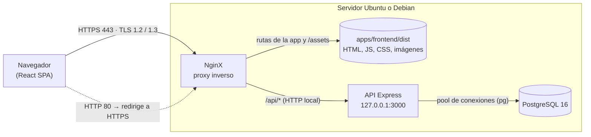
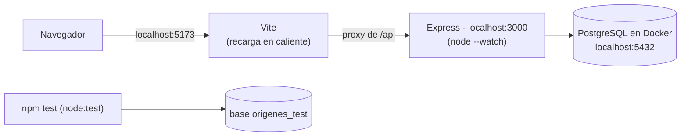
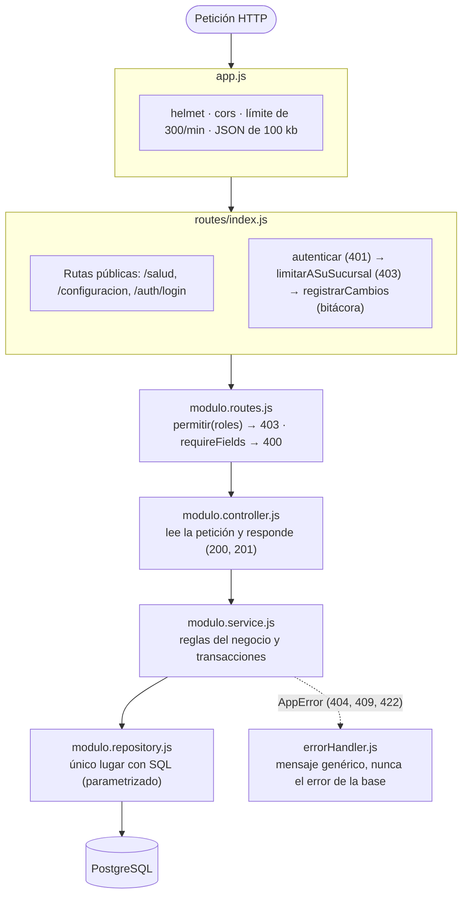
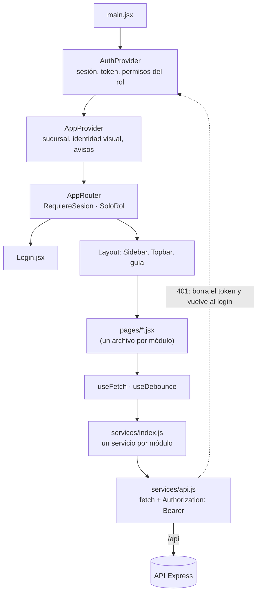
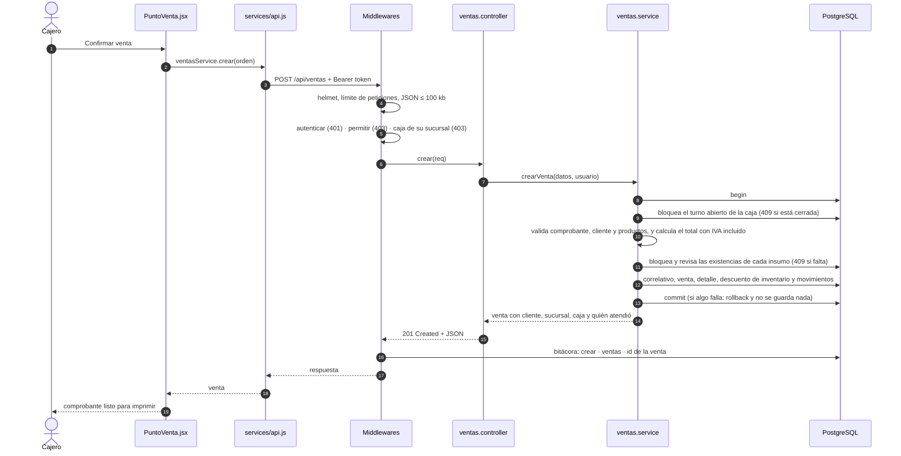
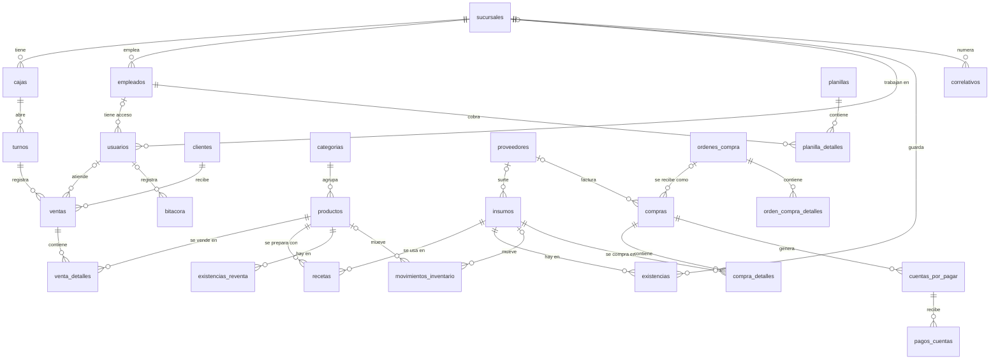

# Arquitectura de Orígenes SV

Orígenes SV es un **monolito modular**: un solo backend en Express organizado por módulos (ventas, caja, inventario…), un frontend en React que se compila a archivos estáticos y una base PostgreSQL. No hay API Gateway ni microservicios (D-03): para un restaurante con pocas sucursales, un monolito bien separado en capas es más simple de desplegar, probar y explicar.

## 1. Vista general en producción

- El navegador solo habla con NginX. NginX entrega el frontend ya compilado y reenvía todo lo que empieza con `/api` a Express, que escucha solo en la máquina (`127.0.0.1`).
- PostgreSQL y el puerto 3000 nunca se exponen a internet (README, sección Despliegue).
- La configuración real está en [`deploy/nginx.conf`](../deploy/nginx.conf) y la API corre como servicio con [`deploy/origenes-api.service`](../deploy/origenes-api.service).

## 2. Vista en desarrollo

`npm run dev` levanta Vite y Express juntos; `npm run db:up` levanta PostgreSQL con `docker-compose.yml`. Las pruebas usan su propia base (`origenes_test`) para no tocar los datos de desarrollo (D-26).

## 3. Capas del backend

| Capa | Responsabilidad | Ejemplo |
|---|---|---|
| `routes` | Ruta, verbo, roles permitidos y campos obligatorios | `router.post('/ventas', permitir(TODOS), requireFields(['cajaId', 'items']), cajaPropia, ventas.crear)` |
| `controller` | Toma los datos de `req` y responde con el código HTTP | `res.status(201).json(venta)` |
| `service` | Reglas del negocio; decide qué va en una transacción | `crearVenta`: caja abierta, IVA, existencias, correlativo |
| `repository` | SQL en minúsculas con `$1, $2…` | `insert into ventas (…) values ($1, $2, …)` |
| `middlewares` | Lo que aplica a muchas rutas | `autenticar`, `permitir`, `registrarCambios`, `errorHandler` |
| `utils` | Cálculos puros, sin base de datos | `desglosarIva`, `calcularDetalleEmpleado`, `leerPaginacion` |

### Módulos

| Módulo | Qué resuelve |
|---|---|
| `auth` | Inicio de sesión (bcrypt + JWT) y `/auth/me` |
| `usuarios` | Accesos: alta, rol, sucursal y desactivación (solo admin) |
| `ventas` | POS: comprobantes FCF y CCF, correlativos, IVA incluido, anulación |
| `productos` | Menú, recetas, productos de reventa y su margen |
| `inventario` | Insumos, existencias por sucursal, entradas, alertas y movimientos |
| `caja` | Apertura y cierre de turnos, cuadre por método de pago |
| `compras` | Proveedores, facturas de costo y gasto, cuentas por pagar y órdenes de compra |
| `rrhh` | Empleados y planilla quincenal (ISSS, AFP y renta) |
| `pronostico` | Consumo proyectado por insumo y pedidos sugeridos |
| `tablero` | Indicadores de Inicio, notificaciones y búsqueda global |
| `general` | Sucursales, clientes, identidad visual, salud y reinicio de datos de demo |
| `bitacora` | Consulta de quién cambió qué y cuándo |

## 4. Capas del frontend

- Las páginas nunca llaman a `fetch` directamente: usan los servicios, que usan `api.js`.
- `utils/permisos.js` decide qué módulos y botones ve cada rol; la API vuelve a revisar cada permiso (403).
- Los componentes visuales están en `components/ui` (botones, paneles, modales…) y `components/decor` (ilustraciones mayas); los estilos son de Tailwind con los colores de la marca como variables CSS.

## 5. Recorrido de una venta, de principio a fin

Las otras operaciones que tocan varias tablas también van en una transacción: compra, anulación, apertura y cierre de caja, entradas de inventario y planilla (manual técnico, sección 1.1).

## 6. Modelo entidad-relación

El esquema completo está en [`database/schema.sql`](../database/schema.sql): 27 tablas con llaves foráneas, `check` para las reglas que no dependen de otras tablas e índices en los campos que se filtran (fechas, sucursal, estado y llaves foráneas).

### Relaciones

`||--o{`: cada fila de la derecha pertenece a exactamente una de la izquierda (llave foránea obligatoria). `|o--o{`: puede no pertenecer a ninguna (llave foránea opcional; por ejemplo, un gasto de luz sin proveedor registrado).

### Tablas por área

| Área | Tablas | Reglas que cuida la base |
|---|---|---|
| Sucursales y caja | `sucursales`, `cajas`, `turnos`, `correlativos` | Un solo turno abierto por caja (índice único parcial); correlativo por sucursal y tipo de comprobante |
| Menú e inventario | `categorias`, `productos`, `recetas`, `insumos`, `existencias`, `existencias_reventa`, `movimientos_inventario` | Existencias nunca negativas; tipo `elaborado` o `reventa`; versión para editar sin pisar cambios |
| Ventas | `clientes`, `ventas`, `venta_detalles` | Comprobante FCF o CCF; el CCF exige NIT y NRC; monto recibido ≥ total |
| Compras | `proveedores`, `compras`, `compra_detalles`, `cuentas_por_pagar`, `pagos_cuentas`, `ordenes_compra`, `orden_compra_detalles` | Una factura no se registra dos veces para el mismo proveedor; tipo `costo` o `gasto` |
| Personal | `empleados`, `planillas`, `planilla_detalles` | Una planilla por quincena (`periodo_inicio` único) |
| Administración | `usuarios`, `bitacora`, `configuracion` | Correo único sin importar mayúsculas (`lower(email)`); rol válido; una sola fila de configuración |

```mermaid
erDiagram
  sucursales ||--o{ cajas : "sucursal_id"
  proveedores |o--o{ insumos : "proveedor_id"
  insumos ||--o{ existencias : "insumo_id"
  sucursales ||--o{ existencias : "sucursal_id"
  categorias ||--o{ productos : "categoria_id"
  productos ||--o{ recetas : "producto_id"
  insumos ||--o{ recetas : "insumo_id"
  productos ||--o{ existencias_reventa : "producto_id"
  sucursales ||--o{ existencias_reventa : "sucursal_id"
  sucursales ||--o{ empleados : "sucursal_id"
  sucursales |o--o{ usuarios : "sucursal_id"
  empleados |o--o{ usuarios : "empleado_id"
  cajas ||--o{ turnos : "caja_id"
  sucursales ||--o{ turnos : "sucursal_id"
  usuarios |o--o{ turnos : "abierto_por"
  usuarios |o--o{ turnos : "cerrado_por"
  sucursales ||--o{ correlativos : "sucursal_id"
  sucursales ||--o{ ventas : "sucursal_id"
  cajas ||--o{ ventas : "caja_id"
  turnos ||--o{ ventas : "turno_id"
  clientes ||--o{ ventas : "cliente_id"
  usuarios |o--o{ ventas : "creado_por"
  ventas ||--o{ venta_detalles : "venta_id"
  productos ||--o{ venta_detalles : "producto_id"
  proveedores |o--o{ ordenes_compra : "proveedor_id"
  sucursales ||--o{ ordenes_compra : "sucursal_id"
  ordenes_compra ||--o{ orden_compra_detalles : "orden_id"
  insumos ||--o{ orden_compra_detalles : "insumo_id"
  proveedores |o--o{ compras : "proveedor_id"
  sucursales ||--o{ compras : "sucursal_id"
  ordenes_compra |o--o{ compras : "orden_compra_id"
  usuarios |o--o{ compras : "creado_por"
  compras ||--o{ compra_detalles : "compra_id"
  insumos ||--o{ compra_detalles : "insumo_id"
  compras ||--o{ cuentas_por_pagar : "compra_id"
  proveedores |o--o{ cuentas_por_pagar : "proveedor_id"
  cuentas_por_pagar ||--o{ pagos_cuentas : "cuenta_id"
  usuarios |o--o{ pagos_cuentas : "registrado_por"
  insumos |o--o{ movimientos_inventario : "insumo_id"
  productos |o--o{ movimientos_inventario : "producto_id"
  sucursales ||--o{ movimientos_inventario : "sucursal_id"
  usuarios |o--o{ planillas : "generada_por"
  planillas ||--o{ planilla_detalles : "planilla_id"
  empleados ||--o{ planilla_detalles : "empleado_id"
  usuarios |o--o{ bitacora : "usuario_id"
  sucursales {
    varchar id PK
    char codigo
    varchar nombre
    varchar direccion
    varchar telefono
    timestamptz creado_en
  }
  cajas {
    varchar id PK
    varchar sucursal_id FK
    varchar nombre
  }
  proveedores {
    varchar id PK
    bigint orden
    varchar nombre
    varchar nit
    varchar nrc
    varchar telefono
    varchar correo
    varchar contacto
    integer dias_credito
    boolean activo
    timestamptz creado_en
    timestamptz actualizado_en
  }
  insumos {
    varchar id PK
    bigint orden
    varchar nombre
    varchar unidad
    numeric stock_minimo
    numeric costo_unitario
    varchar proveedor_id FK
    varchar arte
    boolean activo
    integer version
    timestamptz creado_en
    timestamptz actualizado_en
  }
  existencias {
    varchar insumo_id PK, FK
    varchar sucursal_id PK, FK
    numeric cantidad
  }
  categorias {
    varchar id PK
    bigint orden
    varchar nombre
  }
  productos {
    varchar id PK
    bigint orden
    varchar nombre
    numeric precio
    varchar categoria_id FK
    varchar tipo
    text descripcion
    varchar arte
    text imagen
    numeric costo
    integer stock_minimo
    boolean activo
    integer version
    timestamptz creado_en
    timestamptz actualizado_en
  }
  recetas {
    varchar producto_id PK, FK
    bigint orden
    varchar insumo_id PK, FK
    numeric cantidad
  }
  existencias_reventa {
    varchar producto_id PK, FK
    varchar sucursal_id PK, FK
    integer cantidad
  }
  clientes {
    varchar id PK
    bigint orden
    varchar nombre
    varchar tipo
    varchar nit
    varchar nrc
    varchar giro
    varchar direccion
    varchar telefono
    boolean activo
    timestamptz creado_en
  }
  empleados {
    varchar id PK
    bigint orden
    varchar nombre
    varchar cargo
    varchar sucursal_id FK
    numeric salario_mensual
    varchar dui
    varchar afp
    varchar telefono
    date fecha_ingreso
    varchar estado
    timestamptz creado_en
    timestamptz actualizado_en
  }
  usuarios {
    bigserial id PK
    varchar nombre
    varchar email
    text password_hash
    varchar rol
    varchar sucursal_id FK
    varchar empleado_id FK
    boolean activo
    timestamptz creado_en
    timestamptz actualizado_en
  }
  turnos {
    varchar id PK
    varchar caja_id FK
    varchar sucursal_id FK
    date fecha
    varchar turno
    varchar responsable
    numeric monto_inicial
    jsonb denominaciones
    timestamptz apertura
    timestamptz cierre
    varchar estado
    numeric efectivo_contado
    numeric total_ventas
    numeric total_efectivo
    numeric total_tarjeta
    numeric total_bitcoin
    integer ordenes
    numeric efectivo_esperado
    numeric diferencia
    text observaciones
    bigint abierto_por FK
    bigint cerrado_por FK
  }
  correlativos {
    varchar sucursal_id PK, FK
    varchar tipo PK
    integer ultimo
  }
  ventas {
    varchar id PK
    varchar numero
    varchar tipo_comprobante
    varchar sucursal_id FK
    varchar caja_id FK
    varchar turno_id FK
    timestamptz fecha
    varchar tipo_orden
    varchar cliente_id FK
    varchar metodo_pago
    varchar referencia_pago
    numeric subtotal
    numeric iva
    numeric total
    numeric monto_recibido
    numeric cambio
    varchar estado
    text motivo_anulacion
    bigint creado_por FK
    integer version
  }
  venta_detalles {
    bigserial id PK
    varchar venta_id FK
    varchar producto_id FK
    varchar nombre
    integer cantidad
    numeric precio_unitario
    numeric total
  }
  ordenes_compra {
    varchar id PK
    varchar proveedor_id FK
    varchar proveedor_nombre
    varchar sucursal_id FK
    timestamptz fecha
    numeric total
    varchar estado
    varchar compra_id
  }
  orden_compra_detalles {
    bigserial id PK
    varchar orden_id FK
    varchar insumo_id FK
    varchar nombre
    varchar unidad
    numeric cantidad
    numeric costo_estimado
  }
  compras {
    varchar id PK
    varchar numero_factura
    varchar proveedor_id FK
    varchar proveedor_nombre
    varchar sucursal_id FK
    varchar tipo
    text descripcion
    timestamptz fecha
    numeric subtotal
    numeric iva
    numeric total
    varchar condicion
    varchar orden_compra_id FK
    bigint creado_por FK
    integer version
  }
  compra_detalles {
    bigserial id PK
    varchar compra_id FK
    varchar insumo_id FK
    varchar nombre
    numeric cantidad
    numeric costo_unitario
    numeric total
  }
  cuentas_por_pagar {
    varchar id PK
    varchar compra_id FK
    varchar proveedor_id FK
    varchar proveedor_nombre
    varchar numero_factura
    numeric monto
    numeric saldo
    timestamptz fecha_vencimiento
  }
  pagos_cuentas {
    bigserial id PK
    varchar cuenta_id FK
    timestamptz fecha
    numeric monto
    bigint registrado_por FK
  }
  movimientos_inventario {
    bigserial id PK
    timestamptz fecha
    varchar tipo
    varchar insumo_id FK
    varchar producto_id FK
    varchar sucursal_id FK
    numeric cantidad
    varchar referencia
    varchar motivo
  }
  planillas {
    varchar id PK
    date periodo_inicio
    date periodo_fin
    varchar etiqueta
    timestamptz fecha_generacion
    timestamptz fecha_pago
    varchar estado
    bigint generada_por FK
  }
  planilla_detalles {
    bigserial id PK
    varchar planilla_id FK
    varchar empleado_id FK
    varchar nombre
    varchar cargo
    numeric salario_quincenal
    numeric isss
    numeric afp
    numeric base_gravada
    numeric renta
    varchar tramo_renta
    numeric total_deducciones
    numeric liquido
  }
  configuracion {
    smallint id PK
    jsonb datos
    timestamptz actualizado_en
  }
  bitacora {
    bigserial id PK
    timestamptz fecha
    bigint usuario_id FK
    varchar accion
    varchar entidad
    varchar entidad_id
    jsonb detalle
  }
```

Diagrama completo con todas las columnas (generado desde schema.sql)

